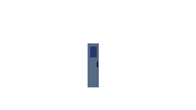
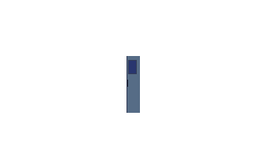
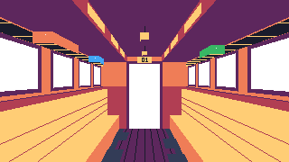

# Le Train des Époques : documentation commune

Projet de groupe, BUT MMI, ressource R3.08 Multimédia.
Équipe : 4 personnes.

Ce fichier est la référence unique du projet. Chaque membre le donne à son IA (ChatGPT, Claude, Copilot, etc.) au début de chaque session de travail, pour que tout le monde produise du code et des images identiques dans leur forme. En cas de doute, c'est ce fichier qui tranche. Toute modification de ce fichier se décide à quatre.

---

## 1. Le concept

L'utilisateur est **à l'intérieur** du train, debout au milieu de l'allée. Il regarde droit devant lui, vers la porte au bout du wagon. La perspective est centrale et symétrique.

Le train compte 4 wagons. Chaque wagon raconte une histoire différente. Pour l'instant, les histoires sont des placeholders (Lorem ipsum).

Des personnages sont assis sur des banquettes le long des deux parois, face à l'allée. L'utilisateur est un spectateur omniscient : il lit leurs pensées dans une bulle qui apparaît au-dessus de la tête du personnage.

### Pensées

| Action utilisateur | Effet |
|---|---|
| Survol d'un personnage à la souris | Sa bulle de pensée apparaît, un contour blanc d'un pixel entoure sa silhouette, le curseur devient une main (aussi sur la porte) |
| Souris hors du personnage | La bulle disparaît |
| Clic ou tap sur un personnage | Sa bulle de pensée apparaît |
| Clic ou tap ailleurs | La bulle disparaît |

- Une seule bulle à la fois. Elle disparaît pendant les changements de wagon.
- Le survol est détecté au pixel près : seuls les pixels visibles du calque du personnage comptent, pas le rectangle de l'image.
- La bulle se place au-dessus du pixel le plus haut du personnage (le haut de la tête). Rien à régler : dessiner le personnage suffit.
- Cette détection lit les pixels des images, ce que le navigateur n'autorise qu'avec un serveur. Il faut donc toujours ouvrir le site avec Live Server, jamais en double-cliquant sur `index.html`.

Le rendu est en **pixel art**, style 16 bits.

### Navigation

| Action utilisateur | Effet |
|---|---|
| Molette vers le bas | Passage au wagon suivant |
| Swipe vers le haut (tactile) | Passage au wagon suivant |
| Flèche droite ou flèche bas | Passage au wagon suivant |
| Clic ou tap sur la porte du fond | Passage au wagon suivant |
| Survol de la porte à la souris | Cadre lumineux autour de la porte et étiquette « Wagon suivant » (« Fin du train » au dernier wagon) |
| Bouton "Arrière" à l'écran | Retour au wagon précédent |

Passage au wagon suivant : la porte du fond s'ouvre, l'écran passe au noir, puis le wagon suivant apparaît.
Retour : fondu au noir, puis le wagon précédent apparaît.

Règles :
- Une action = un seul wagon, jamais plus.
- Pendant une animation, les nouvelles actions sont ignorées (pas de file d'attente).
- Au dernier wagon, la porte est verrouillée : elle tremble légèrement au lieu de s'ouvrir.
- Au premier wagon, le bouton "Arrière" est désactivé.
- Prévu plus tard (pas maintenant) : avancer progressivement dans l'allée, plusieurs crans de molette avant d'atteindre la porte.

---

## 2. Technologies imposées

Uniquement les technologies ci-dessous. Aucune autre bibliothèque, aucun framework, aucun outil n'est ajouté sans accord de toute l'équipe.

| Technologie | Rôle | Chargement |
|---|---|---|
| HTML5 | Structure | Natif |
| CSS3 | Mise en forme, mise en page | Natif, un seul fichier |
| JavaScript (ES6+) | Logique | Natif, sans module ni build |
| GSAP 3 | Animations | CDN |
| GSAP Observer | Détection molette, tactile | CDN |
| Howler.js | Son (plus tard) | CDN |

Interdits : npm, Vite, Webpack, Sass, TypeScript, React, Vue, jQuery, Tailwind, Bootstrap, canvas WebGL, tout framework CSS ou JS.

Test en local : extension Live Server de VS Code (clic droit sur `index.html`, "Open with Live Server"). Obligatoire : sans Live Server, les pensées ne fonctionnent pas.

### Liens CDN (versions figées, tout le monde utilise exactement celles-ci)

À placer à la fin du `<body>`, avant `js/main.js`, dans cet ordre :

```html
<!-- GSAP : moteur d'animation -->
<script src="https://cdnjs.cloudflare.com/ajax/libs/gsap/3.12.5/gsap.min.js"></script>
<!-- Plugin Observer : écoute molette, tactile et pointeur -->
<script src="https://cdnjs.cloudflare.com/ajax/libs/gsap/3.12.5/Observer.min.js"></script>
<!-- Howler : gestion du son (activé plus tard) -->
<script src="https://cdnjs.cloudflare.com/ajax/libs/howler/2.2.4/howler.min.js"></script>
<!-- Notre script, toujours en dernier -->
<script src="js/main.js"></script>
```

Ne jamais changer une version sans prévenir l'équipe.

---

## 3. Structure des fichiers

```
R.308---Multimedia/
├── README.md               présentation courte du dépôt
├── DOCUMENTATION.md        ce fichier
├── index.html              la seule page du site
├── css/
│   └── style.css           tout le style
├── js/
│   └── main.js             toute la logique
└── assets/
    ├── images/
    │   ├── commun/         calques partagés par tous les wagons
    │   │   ├── paysage-ciel.png    ciel fixe vu par les fenêtres
    │   │   ├── paysage-loin.png    montagnes et nuages (défilement lent)
    │   │   ├── paysage-milieu.png  collines (défilement moyen)
    │   │   ├── paysage-proche.png  sol et poteaux (défilement le plus rapide)
    │   │   ├── passage.png         couloir visible derrière la porte ouverte
    │   │   ├── porte-gauche.png    battant gauche de la porte
    │   │   └── porte-droite.png    battant droit de la porte
    │   ├── wagon-01/
    │   │   ├── interieur.png       parois, sol, plafond, banquettes
    │   │   ├── personnage-01.png   un fichier par personnage
    │   │   └── personnage-02.png   ...
    │   ├── wagon-02/
    │   ├── wagon-03/
    │   └── wagon-04/
    └── sons/               fichiers audio (plus tard)
```

Règles :
- On ne crée pas de nouveau fichier ou dossier sans accord de l'équipe (sauf un nouveau `personnage-XX.png` dans son propre wagon).
- Un seul fichier CSS, un seul fichier JS, tant que l'équipe n'a pas décidé autrement.
- Chemins toujours relatifs (`assets/images/commun/passage.png`), jamais absolus (`C:\...` ou `/Users/...`).
- Noms de fichiers : minuscules, sans accent, sans espace, mots séparés par des tirets, numéros sur deux chiffres.
- Les fichiers vides `.gitkeep` servent seulement à garder les dossiers vides dans Git.

---

## 4. Pixel art : règles communes

Ces règles garantissent que les dessins des 4 membres s'assemblent sans retouche.

### Format

- Toile de **320 x 180 pixels** pour chaque calque (format 16:9). Le site l'agrandit sans flou.
- Chaque calque fait toute la toile, même s'il ne contient qu'un petit personnage : le reste est transparent. Pas de positionnement à calculer, il suffit de dessiner au bon endroit.
- Export en **PNG**, fond transparent, sans anticrénelage (pas de pixels semi-transparents sur les bords, pas d'outil flou).
- Les trois couches `paysage-loin.png`, `paysage-milieu.png` et `paysage-proche.png` doivent se raccorder parfaitement à gauche et à droite, car elles défilent en boucle. Leur fond est transparent pour laisser voir la couche de derrière.
- Ces trois couches se dessinent **à plat**, de profil, comme une bande de paysage vue par une fenêtre de face. L'horizon (hauteur des yeux) est sur la **ligne 90**. C'est le site qui les plaque en perspective sur un plan parallèle à chaque paroi, pour qu'elles suivent les fuyantes du wagon et défilent vers le spectateur.
- `paysage-ciel.png` reste plat et fixe (le ciel est à l'infini) : horizon pâle vers la ligne 90.
- Le paysage reste discret : couleurs douces, plus sombres que l'intérieur du wagon, pour que l'oeil reste sur les personnages. Plus une couche est proche, plus elle est sombre.
- Logiciels conseillés : Aseprite, Piskel (gratuit, en ligne), LibreSprite.

### Perspective (repères à respecter)

Point de fuite : **x = 160, y = 90** (centre exact de la toile).

| Élément | Coordonnées sur la toile 320 x 180 |
|---|---|
| Mur du fond | x 114 à 206, y 64 à 142 |
| Ouverture de la porte | x 144 à 176, y 72 à 142 |
| Banquettes | le long des parois, du bas de l'écran jusqu'au mur du fond |
| Fenêtres | sur les parois, au-dessus des banquettes, trouées (transparentes) |

Ouvrir `assets/images/wagon-01/interieur.png` dans son logiciel donne tous ces repères : on peut s'en servir comme gabarit.

### Ordre des calques (de l'arrière vers l'avant)

1. `paysage-ciel.png`, puis `paysage-loin.png`, `paysage-milieu.png`, `paysage-proche.png` (derrière les fenêtres)
2. `passage.png` (derrière la porte)
3. `porte-gauche.png` et `porte-droite.png`
4. `interieur.png` (avec trous transparents pour les fenêtres et la porte)
5. `personnage-XX.png`, du plus éloigné au plus proche

### Palette

Palette commune : **Sweetie 16** (16 couleurs). Tout le monde l'importe dans son logiciel.

```
#1a1c2c  #5d275d  #b13e53  #ef7d57
#ffcd75  #a7f070  #38b764  #257179
#29366f  #3b5dc9  #41a6f6  #73eff7
#f4f4f4  #94b0c2  #566c86  #333c57
```

Chaque wagon peut ajouter au maximum **3 couleurs propres** pour son ambiance. Elles sont notées dans le tableau des wagons (section 6).

---

## 5. Conventions de code communes

### Règles générales

- Indentation : 2 espaces (pas de tabulation). Dans VS Code : "Spaces: 2" en bas à droite.
- Encodage : UTF-8.
- Commentaires en français, clairs, au-dessus du bloc qu'ils expliquent.
- Noms de variables, fonctions et classes CSS : **français sans accent** (ex. `wagonActuel`, `.wagon__calque`).
- Aucun emoji, ni dans le code, ni dans les commentaires, ni dans les textes du site.
- Pas de code mort ni de `console.log` oubliés dans ce qui est partagé.

### HTML

- `<html lang="fr">`, `<meta charset="UTF-8">`, `<meta name="viewport" ...>`.
- Chaque wagon est une `<section class="wagon">` avec `data-titre` (nom affiché dans l'indicateur) :
  ```html
  <section class="wagon" data-titre="Lorem ipsum">
    
    
    
    
    
  </section>
  ```
- Chaque personnage porte sa pensée dans `data-pensee`. Pour l'instant ce sont des phrases en Lorem ipsum, à remplacer par les vraies pensées. Le texte reste court (une ou deux phrases), sinon la bulle devient trop grande.
- Les calques décoratifs ont `alt=""`, les personnages et l'intérieur ont un `alt` descriptif en français.
- Pas de style en ligne (`style="..."`) ni de script en ligne (`onclick="..."`).

### CSS

- Nommage des classes en BEM : `bloc`, `bloc__element`, `bloc--variante`.
- Couleurs, tailles et durées en variables dans `:root`, en haut du fichier.
- Toutes les images pixel art ont `image-rendering: pixelated` (sinon elles sont floues).
- Ordre du fichier, séparé par des commentaires de section :
  1. Variables
  2. Reset et base
  3. Scène (cadre 16:9)
  4. Paysage
  5. Wagons et calques
  6. Pensées (bulles)
  7. Interface (indicateur, bouton Arrière)
  8. Responsive (media queries)
- Pas de `!important`. Pas d'`id` pour styler.
- Les animations se font en GSAP, pas en CSS.

### JavaScript

- `const` par défaut, `let` si la valeur change, jamais `var`.
- Fonctions nommées et courtes, une seule responsabilité chacune.
- camelCase pour variables et fonctions (`allerAuWagon`), MAJUSCULES pour les constantes de réglage (`DUREE_PORTE`).
- Le DOM est sélectionné une seule fois au début du fichier.
- Organisation de `main.js`, avec un commentaire de section pour chaque partie :
  1. Réglages (constantes)
  2. Sélection des éléments du DOM
  3. État (wagon actuel, animation en cours)
  4. Fonctions
  5. Ambiance (animations permanentes : paysage, lumière, secousses)
  6. Écouteurs (Observer, clavier, bouton)
  7. Initialisation
- Commentaire en tête de chaque fonction, qui dit ce qu'elle fait et ce que sont ses paramètres.
- Le nombre de wagons n'est jamais écrit en dur : le JavaScript les compte dans le HTML.

### Animations (GSAP)

- Durées communes, définies dans les réglages de `main.js` : ouverture de porte 0,7 s, fondu au noir 0,4 s.
- Pour garder l'aspect pixel art, les mouvements des calques utilisent l'easing `steps(n)` (déplacement pixel par pixel).
- Un booléen `enAnimation` bloque toute nouvelle action tant qu'une transition est en cours.
- Ambiance volontairement calme : le paysage défile en 120 s (loin), 60 s (milieu) et 30 s (proche) par largeur d'écran, la secousse revient toutes les 6 à 9 s, le scintillement toutes les 15 à 30 s. Ces réglages sont en haut de `main.js`.
- Respect de `prefers-reduced-motion` : si l'utilisateur le demande, pas de secousses et transitions raccourcies.

---

## 6. Les wagons

L'ordre de ce tableau est l'ordre du train.

| N° | Dossier | Histoire | Couleurs propres | Responsable | État |
|---|---|---|---|---|---|
| 01 | `wagon-01` | Placeholder (Lorem ipsum) | aucune | à définir | placeholder |
| 02 | `wagon-02` | Placeholder (Dolor sit amet) | aucune | à définir | placeholder |
| 03 | `wagon-03` | Placeholder (Consectetur) | aucune | à définir | placeholder |
| 04 | `wagon-04` | Placeholder (Adipiscing elit) | aucune | à définir | placeholder |

Ajouter ou retirer un wagon = ajouter ou retirer une `<section class="wagon">` dans le HTML et son dossier d'images.

---

## 7. Organisation du travail en équipe

- Chacun travaille sur sa partie (un wagon, ou une fonctionnalité), sans réécrire celle des autres.
- Remplacer un placeholder = remplacer le fichier PNG en gardant exactement le même nom et la même taille. Aucun code à toucher.
- Avant de modifier une partie commune (`index.html` hors de son wagon, `main.js`, variables CSS, calques du dossier `commun`), on prévient le groupe.
- On garde toujours une version qui fonctionne : on ne partage jamais un code qui casse le site.
- Si l'équipe utilise Git : une branche par personne ou par fonctionnalité, messages de commit en français à l'impératif (ex. `Ajoute les personnages du wagon 02`).

---

## 8. Règles pour les IA

Copier le bloc ci-dessous en début de conversation avec son IA, avec ce fichier en pièce jointe.

```
Tu m'aides sur un projet scolaire de groupe (BUT MMI, R3.08 Multimédia).
Le fichier DOCUMENTATION.md joint est la référence absolue : respecte
strictement ses technologies, sa structure, ses conventions de nommage,
ses règles de pixel art et l'organisation de ses fichiers. Nous sommes 4
et nos IA doivent produire du code et des images identiques dans leur forme.

Règles :
- HTML, CSS et JavaScript natifs uniquement, GSAP + Observer et Howler
  via les liens CDN donnés. N'ajoute aucune autre bibliothèque, aucun
  outil de build, aucun fichier ou dossier non prévu sans me demander.
- Pixel art : calques de 320 x 180 pixels, PNG transparent, palette
  Sweetie 16, perspective centrée sur le point de fuite (160, 90).
- Commente le code en français. Aucun emoji nulle part.
- Avance étape par étape : un fichier ou une modification à la fois.
  Pour chacun, explique brièvement ce qu'il contient et pourquoi, puis
  attends ma validation avant de passer à la suite.
- Ne réécris pas les parties du code qui ne concernent pas ma demande.
  Montre uniquement ce qui change et où le placer.
- N'ajoute pas les pensées des personnages, le son ou les vraies
  illustrations sans que je le demande explicitement.
- Si une demande contredit DOCUMENTATION.md, signale-le avant d'agir.
```

---

## 9. Étapes du projet

Chaque étape est validée par l'équipe avant de passer à la suivante.

1. Documentation commune (fait)
2. Maquette : 4 wagons en perspective, placeholders pixel art, navigation porte et bouton Arrière (fait)
3. Choix des 4 histoires et répartition des wagons entre les membres
4. Pensées : bulle au survol ou au toucher d'un personnage (fait, textes en Lorem ipsum)
5. Illustrations définitives de chaque wagon (après validation)
6. Son avec Howler (après validation)
7. Avancée progressive dans l'allée à la molette (plus tard)
8. Responsive, accessibilité, tests sur plusieurs navigateurs
