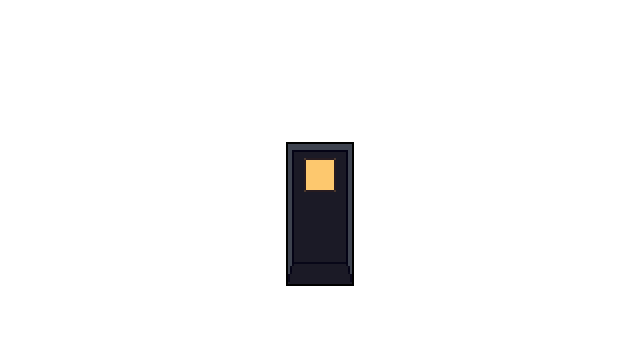
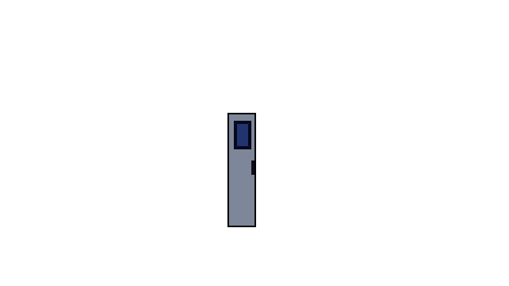
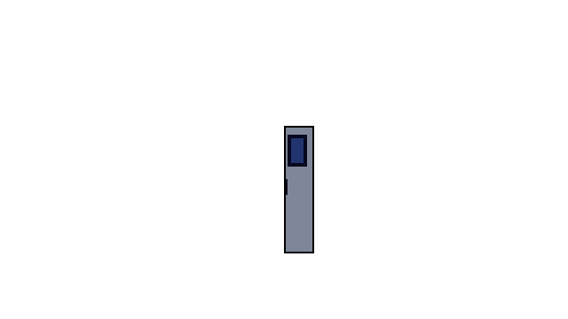
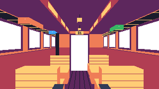
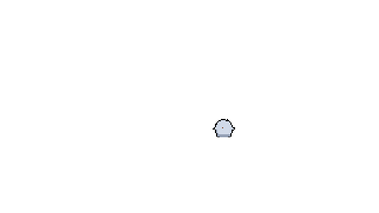

# Le Train des Époques : documentation commune

Projet de groupe, BUT MMI, ressource R3.08 Multimédia.
Équipe : 4 personnes.

Ce fichier est la référence unique du projet. Chaque membre le donne à son IA (ChatGPT, Claude, Copilot, etc.) au début de chaque session de travail, pour que tout le monde produise du code et des images identiques dans leur forme. En cas de doute, c'est ce fichier qui tranche. Toute modification de ce fichier se décide à quatre.

---

## 1. Le concept

L'utilisateur est **à l'intérieur** du train, debout au milieu de l'allée. Il regarde droit devant lui, vers la porte au bout du wagon. La perspective est centrale et symétrique.

Le train compte 4 wagons. Chaque wagon raconte une histoire différente. Pour l'instant, les histoires sont des placeholders (Lorem ipsum).

Des personnages sont assis dans le wagon. Selon l'architecture du wagon, on les voit de côté (banquettes le long des parois), de face ou de dos (banquettes en travers). L'utilisateur est un spectateur omniscient : il lit leurs pensées dans une bulle qui apparaît au-dessus de la tête du personnage.

### Pensées

| Action utilisateur | Effet |
|---|---|
| Survol d'un personnage à la souris | Sa bulle de pensée apparaît, un contour blanc fin entoure sa silhouette, le curseur devient un oeil (une main sur la porte) |
| Souris hors du personnage | La bulle disparaît |
| Clic ou tap sur un personnage | Sa bulle de pensée apparaît |
| Clic ou tap ailleurs, ou touche Échap | La bulle disparaît |

- Une seule bulle à la fois. Elle disparaît pendant les changements de wagon.
- La bulle est un nuage pixel art (`assets/images/interface/bulle-cadre.png`, découpé en 9 morceaux par le CSS) relié à la tête par deux petites bulles (`bulle-queue.png`). Elle affiche le prénom du personnage (`data-nom`) puis sa pensée, écrite lettre par lettre.
- Le survol est détecté au pixel près : seuls les pixels visibles du calque du personnage comptent, pas le rectangle de l'image.
- La bulle se place au-dessus du pixel le plus haut du personnage (le haut de la tête). Rien à régler : dessiner le personnage suffit.
- Un personnage qui « parle » en code (Erine, qui ne parle qu'en PHP) porte `data-langage="php"` : sa pensée s'écrit en violet, comme du code (`<?php echo "..."; ?>`).
- Cette détection lit les pixels des images, ce que le navigateur n'autorise qu'avec un serveur. Il faut donc toujours ouvrir le site avec Live Server, jamais en double-cliquant sur `index.html`.

Le rendu est en **pixel art 2D**, dans le style de Joaquim (le personnage de Lino) : voir la charte de direction artistique, section 4.

### Navigation

| Action utilisateur | Effet |
|---|---|
| Molette vers le bas | Passage au wagon suivant |
| Swipe vers le haut (tactile) | Passage au wagon suivant |
| Flèche droite ou flèche bas | Passage au wagon suivant |
| Flèche gauche ou flèche haut | Retour au wagon précédent |
| Clic ou tap sur la porte du fond | Passage au wagon suivant |
| Survol de la porte à la souris | Cadre lumineux autour de la porte et étiquette « Wagon suivant » (« Fin du train » au dernier wagon) |
| Bouton "Arrière" à l'écran | Retour au wagon précédent |

Passage au wagon suivant : la porte du fond s'ouvre pendant que la vue s'approche d'elle (zoom), l'écran passe au noir, puis le wagon suivant apparaît avec un léger recul.
Retour : fondu au noir, puis le wagon précédent apparaît.
À chaque arrivée, un carton « Wagon 0X » et le titre du wagon (`data-titre`) s'affichent 1,5 s en haut de la scène.

### Accueil et interface

- Au chargement, un écran d'accueil (titre et consignes) couvre la fenêtre, le train roule déjà derrière. Le premier geste (clic, tap, molette, swipe ou touche) le ferme sans changer de wagon.
- En haut à gauche, l'indicateur montre un petit train (un wagon par `section.wagon`, le wagon actuel allumé en jaune), le numéro et le titre du wagon.
- Signes de vie : chaque voyageur se soulève d'un pixel de temps en temps (respiration). Après 8 s sans action, le cadre de la porte clignote doucement pour montrer où aller (sauf au dernier wagon).

Règles :
- Une action = un seul wagon, jamais plus.
- Pendant une animation, les nouvelles actions sont ignorées (pas de file d'attente).
- Au dernier wagon, la porte est verrouillée : elle tremble légèrement au lieu de s'ouvrir.
- Au premier wagon, le bouton "Arrière" est désactivé.
- Prévu plus tard (pas maintenant) : avancer progressivement dans l'allée, plusieurs crans de molette avant d'atteindre la porte.

---

## 2. Technologies imposées

Uniquement les technologies ci-dessous. Aucune autre bibliothèque, aucun framework, aucun outil n'est ajouté sans accord de toute l'équipe.

| Technologie | Rôle | Chargement |
|---|---|---|
| HTML5 | Structure | Natif |
| CSS3 | Mise en forme, mise en page | Natif, un seul fichier |
| JavaScript (ES6+) | Logique | Natif, sans module ni build |
| GSAP 3 | Animations | CDN |
| GSAP Observer | Détection molette, tactile | CDN |
| Howler.js | Son (plus tard) | CDN |

Interdits : npm, Vite, Webpack, Sass, TypeScript, React, Vue, jQuery, Tailwind, Bootstrap, canvas WebGL, tout framework CSS ou JS.

Test en local : extension Live Server de VS Code (clic droit sur `index.html`, "Open with Live Server"). Obligatoire : sans Live Server, les pensées ne fonctionnent pas.

### Liens CDN (versions figées, tout le monde utilise exactement celles-ci)

À placer à la fin du `<body>`, avant `js/main.js`, dans cet ordre :

```html
<!-- GSAP : moteur d'animation -->
<script src="https://cdnjs.cloudflare.com/ajax/libs/gsap/3.12.5/gsap.min.js"></script>
<!-- Plugin Observer : écoute molette, tactile et pointeur -->
<script src="https://cdnjs.cloudflare.com/ajax/libs/gsap/3.12.5/Observer.min.js"></script>
<!-- Howler : gestion du son (activé plus tard) -->
<script src="https://cdnjs.cloudflare.com/ajax/libs/howler/2.2.4/howler.min.js"></script>
<!-- Notre script, toujours en dernier -->
<script src="js/main.js"></script>
```

Ne jamais changer une version sans prévenir l'équipe.

---

## 3. Structure des fichiers

```
R.308---Multimedia/
├── README.md               présentation courte du dépôt
├── DOCUMENTATION.md        ce fichier
├── index.html              la seule page du site
├── css/
│   └── style.css           tout le style
├── js/
│   └── main.js             toute la logique
└── assets/
    ├── images/
    │   ├── commun/         calques partagés par tous les wagons
    │   │   ├── paysage-ciel.png    ciel fixe vu par les fenêtres
    │   │   ├── paysage-loin.png    montagnes et nuages (défilement lent)
    │   │   ├── paysage-milieu.png  collines (défilement moyen)
    │   │   ├── paysage-proche.png  sol et poteaux (défilement le plus rapide)
    │   │   ├── passage.png         couloir visible derrière la porte ouverte
    │   │   ├── porte-gauche.png    battant gauche de la porte
    │   │   └── porte-droite.png    battant droit de la porte
    │   ├── interface/      petites images d'interface (pas au format 640 x 360)
    │   │   ├── bulle-cadre.png     cadre en nuage de la bulle (24 x 24, 9 morceaux de 8 x 8)
    │   │   ├── bulle-queue.png     petites bulles entre le nuage et la tête (7 x 11)
    │   │   └── curseur-oeil.png    curseur sur un personnage (32 x 32)
    │   ├── wagon-01/
    │   │   ├── interieur.png       parois, sol, plafond (sans les bancs)
    │   │   ├── banc-01.png         rangée de bancs du fond (et poêle), puis banc-02 au milieu, banc-03 devant
    │   │   ├── erine.png           sprite d'Erine dessiné par Inas (source, pas affiché tel quel)
    │   │   ├── personnage-01.png   un fichier par personnage
    │   │   └── personnage-02.png   ...
    │   ├── wagon-02/
    │   │   ├── fumee.png           bouffées de vapeur dehors (calque facultatif, voir section 4)
    │   │   └── lueurs.png          halos des lampes (calque facultatif, voir section 4)
    │   ├── wagon-03/
    │   └── wagon-04/
    └── sons/               fichiers audio (plus tard)
```

Règles :
- On ne crée pas de nouveau fichier ou dossier sans accord de l'équipe (sauf un nouveau `personnage-XX.png` dans son propre wagon).
- Un seul fichier CSS, un seul fichier JS, tant que l'équipe n'a pas décidé autrement.
- Chemins toujours relatifs (`assets/images/commun/passage.png`), jamais absolus (`C:\...` ou `/Users/...`).
- Noms de fichiers : minuscules, sans accent, sans espace, mots séparés par des tirets, numéros sur deux chiffres.
- Les fichiers vides `.gitkeep` servent seulement à garder les dossiers vides dans Git.

---

## 4. Direction artistique et pixel art : règles communes

Ces règles garantissent que les dessins des 4 membres s'assemblent sans retouche.

### Charte de direction artistique (DA « Joaquim »)

La référence visuelle du projet est **Joaquim**, le personnage dessiné par Lino (sprite de 70 x 144 pixels, assis sur une banquette du wagon 01 : `assets/images/wagon-01/personnage-02.png`). Tout ce qu'on dessine doit pouvoir s'asseoir à côté de lui sans faire tache. L'esprit : de la 2D simple, colorée et expressive, comme les jeux Pokémon en 2D. Pas de 3D, pas de rendu réaliste.

| Règle | Concrètement |
|---|---|
| 2D à plat | Aplats de couleur, pas de dégradé lisse, pas de flou, pas de texture photo. La perspective du wagon reste (point de fuite au centre), mais tout est dessiné à plat dedans. |
| Même taille de pixel | Un pixel de Joaquim fait 2 x 2 pixels de l'image : tout le projet est dessiné à cette taille (grille de 320 x 180 doublée, voir Format). Jamais de détail plus fin. |
| Contour noir | Chaque personnage est cerné d'un trait noir `#000000` d'un pixel de grille, tout autour de sa silhouette (comme Joaquim). |
| Encrage du décor | Entre deux zones de couleur du décor (deux faces d'un meuble, un cadre de fenêtre, une porte), un trait d'un pixel plus sombre que la couleur. Autour des trous (fenêtres, porte), un trait noir. |
| Ombres simples | Une couleur de base, une ombre (plus sombre et un peu bleutée, jamais grise) et au besoin un reflet clair. Trois tons par matière, pas plus. |
| Couleurs vives | Couleurs franches et saturées, paysage de beau temps (ciel bleu, collines vertes). Une ambiance plus sombre est permise si le wagon le demande (le salon vapeur, chaud et feutré). |
| Personnages | Proportions et ombrages de Joaquim : tête d'environ un quart de la hauteur du personnage assis, corps large d'environ la moitié de sa hauteur bras compris, chemise blanche à plis gris, deux tons par vêtement, trait noir entre les pièces. Les voyageurs provisoires sont des variantes de Joaquim (couleurs, coiffure, lunettes ; au wagon 02, chapeaux, moustaches, robes longues de 1900) en attendant que chacun dessine son propre sprite. |
| Pixel net | Pixels pleins uniquement : pas d'anticrénelage, pas de pixel semi-transparent. Les trames (un pixel sur deux) sont permises pour les lumières et la vapeur. |
| Pas de mise à l'échelle | Un sprite se dessine directement à sa taille finale, jamais agrandi ou réduit après coup (sinon les pixels ne sont plus de la même taille que ceux de Joaquim). |

Taille des personnages : un adulte assis mesure **72 pixels de grille** de haut (144 dans l'image finale, comme Joaquim) quand il est au milieu du wagon, au niveau de Joaquim. Un voyageur vu de dos, plus loin ou plus près, se place par le haut de sa tête : seuls la tête et les épaules dépassent du dossier.

Interface : boutons et étiquettes façon boîte de dialogue de jeu 2D (fond blanc, trait noir, ombre pleine), titre d'accueil jaune cerné de bleu nuit.

Pour vérifier un dessin : l'ouvrir à côté de `wagon-01/personnage-02.png` (Joaquim) au même zoom. Mêmes tailles de pixels, même épaisseur de trait, couleurs aussi vives : c'est bon.

### Format

- Image de **640 x 360 pixels** pour chaque calque (format 16:9). Le site l'agrandit sans flou.
- **Taille des pixels** : Joaquim est dessiné en gros pixels de 2 x 2. Tout le reste aussi : on dessine sur une grille de **320 x 180**, puis on double l'image (agrandissement x 2 « au plus proche », sans lissage) pour obtenir le 640 x 360. Un pixel de la grille = un pixel de Joaquim. Les coordonnées données plus bas sont celles de l'image finale 640 x 360 (diviser par 2 pour la grille).
- Chaque calque fait toute la toile, même s'il ne contient qu'un petit personnage : le reste est transparent. Pas de positionnement à calculer, il suffit de dessiner au bon endroit.
- Export en **PNG**, fond transparent, sans anticrénelage (pas de pixels semi-transparents sur les bords, pas d'outil flou).
- Les trois couches `paysage-loin.png`, `paysage-milieu.png` et `paysage-proche.png` doivent se raccorder parfaitement à gauche et à droite, car elles défilent en boucle. Leur fond est transparent pour laisser voir la couche de derrière.
- Ces trois couches se dessinent **à plat**, de profil, comme une bande de paysage vue par une fenêtre de face. L'horizon (hauteur des yeux) est sur la **ligne 180**. C'est le site qui les plaque en perspective sur un plan parallèle à chaque paroi, pour qu'elles suivent les fuyantes du wagon et défilent vers le spectateur.
- `paysage-ciel.png` reste plat et fixe (le ciel est à l'infini) : horizon pâle vers la ligne 180.
- Paysage de beau temps, contours sombres comme le reste. Plus une couche est proche, plus elle est sombre, pour que l'oeil reste sur les personnages.
- Logiciels conseillés : Aseprite, Piskel (gratuit, en ligne), LibreSprite.

### Perspective (repères à respecter)

Point de fuite : **x = 320, y = 180** (centre exact de la toile).

| Élément | Coordonnées sur la toile 640 x 360 |
|---|---|
| Mur du fond | x 228 à 412, y 128 à 284 (son haut suit la forme du plafond du wagon : plat, voûté, surélevé...) |
| Ouverture de la porte | x 288 à 352, y 144 à 284 |
| Banquettes | le long des parois, du bas de l'écran jusqu'au mur du fond |
| Fenêtres | sur les parois, au-dessus des banquettes, trouées (transparentes). Nombre, taille et forme libres selon le wagon |
| Panneau numéroté | x 304 à 335, y 126 à 139, au-dessus de la porte (numéro du wagon sur deux chiffres, chiffres de 6 x 10 pixels) |
| Personnages | de préférence de face, tournés vers le spectateur, pour qu'on voie chaque visage. Rangée du milieu : bord avant de l'assise à la profondeur de Joaquim (le dessous des cuisses vers y 298). Seule la rangée de devant peut être coupée par le bas de l'écran (on n'en voit que le haut du corps) |

Ouvrir `assets/images/wagon-01/interieur.png` dans son logiciel donne tous ces repères : on peut s'en servir comme gabarit.

### Ordre des calques (de l'arrière vers l'avant)

1. `paysage-ciel.png`, puis `paysage-loin.png`, `paysage-milieu.png`, `paysage-proche.png` (derrière les fenêtres)
2. `fumee.png` (facultatif, classe `wagon__fumee`) : ce qui passe dehors, propre au wagon
3. `passage.png` (derrière la porte)
4. `porte-gauche.png` et `porte-droite.png`
5. `interieur.png` (avec trous transparents pour les fenêtres et la porte)
6. `lueurs.png` (facultatif, classe `wagon__lueur`) : halos des lampes
7. `personnage-XX.png`, du plus éloigné au plus proche. Dans un wagon à bancs en calques (wagon 01), chaque rangée de voyageurs vient juste après le calque de son banc : `banc-01`, `banc-02`, voyageurs du milieu, `banc-03`, voyageurs de devant.

Calques facultatifs d'ambiance, utilisables par tous les wagons (le wagon 02 sert d'exemple) :
- `wagon__fumee` : dessiné loin dehors, sur les plans du paysage (profondeur 3 à 6). `main.js` l'agrandit en boucle depuis le point de fuite, ce qui fait glisser son contenu le long des fenêtres vers le spectateur. Mettre trois fois la même image dans la section : les copies sont décalées dans le temps pour un défilement continu.
- `wagon__lueur` : halos tramés (pixels pleins, un sur deux ou un sur quatre) autour des lampes. Le CSS les ajoute à l'image en mode écran (`mix-blend-mode: screen`) et `main.js` fait vaciller leur opacité comme une flamme.

Les personnages sont toujours au-dessus de l'intérieur. Si un siège placé devant un voyageur doit le cacher en partie (banquette de la rangée de devant, dossier), on le met dans **un calque de décor à part**, placé après le voyageur dans `index.html` (comme `banc-03` au wagon 01). Le voyageur est alors dessiné **en entier**, sans le découper à la main : c'est l'ordre des calques qui cache le bas de son corps (méthode proposée par Lilian). Au chargement, `main.js` retire du survol les pixels du voyageur recouverts par un calque de décor posé après lui : seule sa partie visible réagit. Les calques d'ambiance (`wagon__lueur`, `wagon__fumee`) ne comptent pas. Un voyageur déjà découpé (wagon 02) marche aussi.

### Palette

Palette commune **« Joaquim »** : les couleurs du sprite de Joaquim, complétées de teintes vives. Tout le monde l'importe dans son logiciel.

```
Contour   #000000
Encre     #1b1a26   nuit      #22346e   gris foncé #3e434f   gris      #7d8799
Blancs    #ffffff   #d1dae9   crème     #f6e7c1
Peaux     #ffb096 (ombre #d3856b)   #e0996b   #9a5b3c
Bois      #d29a5c   #9b6846   #5c2f17   cheveux bruns #44100a
Rouges    #d8364b   bordeaux  #770013   orange    #f58a4c   jaune     #fdc86e
Verts     #9be564   #3fae5a   #2a8c8c
Bleus     #1882de   #5cc1f7   #8af0f0   violet    #6a3d8f
```

Les ombres se font en assombrissant la couleur de base d'environ moitié, en tirant un peu vers le bleu (le générateur le fait tout seul).

Chaque wagon a sa propre **architecture** (époque du train : plafond, parois, fenêtres, sièges, éclairage). Ce qui ne change jamais d'un wagon à l'autre : le point de fuite, l'ouverture de la porte, le panneau numéroté et la place des personnages sur les banquettes.

Chaque wagon peut ajouter **quelques couleurs propres** (5 au maximum) pour son ambiance. Elles sont notées dans le tableau des wagons (section 6).

### Personnages dessinés à la main

Un personnage dessiné par un membre (comme Joaquim par Lino, ou Erine par Inas) se pose tel quel dans son wagon. Le plus simple :
- dessiner le sprite seul, assis **de face** (tourné vers le spectateur), détouré, avec son contour noir, à la même taille que Joaquim : environ 72 pixels de grille de haut, donc 144 une fois doublé (`joaquim.png` et `erine.png` sont sur une toile de 168 x 168) ;
- le déposer dans le dossier du wagon sous son prénom (comme `wagon-01/erine.png`) et prévenir Lino : il le met à la place du voyageur provisoire, assis sur sa banquette, le banc de devant passant par-dessus lui ;
- les voyageurs provisoires des wagons 01 et 02 attendent tous leur sprite : chacun peut dessiner le sien.

---

## 5. Conventions de code communes

### Règles générales

- Indentation : 2 espaces (pas de tabulation). Dans VS Code : "Spaces: 2" en bas à droite.
- Encodage : UTF-8.
- Commentaires en français, clairs, au-dessus du bloc qu'ils expliquent.
- Noms de variables, fonctions et classes CSS : **français sans accent** (ex. `wagonActuel`, `.wagon__calque`).
- Aucun emoji, ni dans le code, ni dans les commentaires, ni dans les textes du site.
- Pas de code mort ni de `console.log` oubliés dans ce qui est partagé.

### HTML

- `<html lang="fr">`, `<meta charset="UTF-8">`, `<meta name="viewport" ...>`.
- Chaque wagon est une `<section class="wagon">` avec `data-titre` (nom affiché dans l'indicateur) :
  ```html
  <section class="wagon" data-titre="Lorem ipsum">
    
    
    
    
    
  </section>
  ```
- Chaque personnage porte son prénom dans `data-nom` (affiché en haut de sa bulle) et sa pensée dans `data-pensee`. Un personnage qui pense en code ajoute `data-langage="php"` (bulle de code, voir section 1). Pour l'instant ce sont des phrases en Lorem ipsum, à remplacer par les vraies pensées. Le texte reste court (une ou deux phrases), sinon la bulle devient trop grande.
- Les calques décoratifs ont `alt=""`, les personnages et l'intérieur ont un `alt` descriptif en français.
- Pas de style en ligne (`style="..."`) ni de script en ligne (`onclick="..."`).

### CSS

- Nommage des classes en BEM : `bloc`, `bloc__element`, `bloc--variante`.
- Couleurs, tailles et durées en variables dans `:root`, en haut du fichier.
- Toutes les images pixel art ont `image-rendering: pixelated` (sinon elles sont floues).
- Ordre du fichier, séparé par des commentaires de section :
  1. Variables
  2. Reset et base
  3. Scène (cadre 16:9)
  4. Paysage
  5. Wagons et calques
  6. Pensées (bulles)
  7. Interface (indicateur, bouton Arrière, carton titre, accueil)
  8. Responsive (media queries)
- Pas de `!important`. Pas d'`id` pour styler.
- Les animations se font en GSAP, pas en CSS.

### JavaScript

- `const` par défaut, `let` si la valeur change, jamais `var`.
- Fonctions nommées et courtes, une seule responsabilité chacune.
- camelCase pour variables et fonctions (`allerAuWagon`), MAJUSCULES pour les constantes de réglage (`DUREE_PORTE`).
- Le DOM est sélectionné une seule fois au début du fichier.
- Organisation de `main.js`, avec un commentaire de section pour chaque partie :
  1. Réglages (constantes)
  2. Sélection des éléments du DOM
  3. État (wagon actuel, animation en cours)
  4. Fonctions
  5. Ambiance (animations permanentes : paysage, lumière, secousses)
  6. Écouteurs (Observer, clavier, bouton)
  7. Initialisation
- Commentaire en tête de chaque fonction, qui dit ce qu'elle fait et ce que sont ses paramètres.
- Le nombre de wagons n'est jamais écrit en dur : le JavaScript les compte dans le HTML.

### Animations (GSAP)

- Durées communes, définies dans les réglages de `main.js` : ouverture de porte 0,7 s, fondu au noir 0,4 s, carton titre 1,5 s, écriture d'une pensée 0,025 s par lettre.
- Pour garder l'aspect pixel art, les mouvements des calques utilisent l'easing `steps(n)` (déplacement pixel par pixel).
- Un booléen `enAnimation` bloque toute nouvelle action tant qu'une transition est en cours.
- Ambiance volontairement calme : le paysage défile en 120 s (loin), 60 s (milieu) et 30 s (proche) par largeur d'écran, la secousse revient toutes les 6 à 9 s, le scintillement toutes les 15 à 30 s, une bouffée de fumée met 9 s à passer, les lampes vacillent toutes les 0,08 à 0,35 s. Ces réglages sont en haut de `main.js`.
- Respect de `prefers-reduced-motion` : si l'utilisateur le demande, pas de secousses, de respiration, de fumée qui défile, de lampes qui vacillent ni de zoom, pensée affichée d'un coup et transitions raccourcies.

---

## 6. Les wagons

L'ordre de ce tableau est l'ordre du train.

| N° | Dossier | Architecture (placeholder) | Histoire | Couleurs propres | Responsable | État |
|---|---|---|---|---|---|---|
| 01 | `wagon-01` | Voiture en bois clair (placeholder) : banquettes en bois toutes tournées vers le spectateur (rangée du milieu, rangée de devant à dossier bas, coupée par le bas de l'écran), poêle à charbon, toit à lanterneau, lampes suspendues. Bancs en calques séparés (`banc-01` à `banc-03`). Les 8 élèves : au milieu Lino, Joaquim, Inas et Erine ; devant Lilian, Raphaël, Liku et Alio | Placeholder (Lorem ipsum), futur wagon MMI | aucune en plus de la palette | à définir | Joaquim et Erine dessinés à la main, les 6 autres provisoires (variantes de Joaquim) |
| 02 | `wagon-02` | Voiture-salon de 1re classe d'un train à vapeur (vers 1900) : voûte en acajou à caissons, filets de laiton, fenêtres cintrées à rideaux de velours et lambrequins, appliques et lampes à gaz, fauteuils pivotants de velours capitonnés tournés vers le spectateur, guéridons à nappe blanche, tapis d'Orient, tableaux au mur du fond. Dehors, la fumée de la locomotive passe devant les fenêtres. Les 5 professeurs en tenue 1900 : Mr Blanco (melon), Mr Bernard (haut-de-forme, monocle), Mme De velder (chapeau à plume), Mme Pitot (chignon), Mr Gassin (canotier, au premier plan) | Le Salon à vapeur (pensées en Lorem ipsum) | acajou `#7a3b2e`, acajou sombre `#47212a`, laiton `#c98f3e`, velours `#b3263f`, velours prune `#5e1f45` | à définir | illustration v2 (DA Joaquim), professeurs provisoires (variantes de Joaquim) |
| 03 | `wagon-03` | Voiture Corail (années 1980) : rangées de sièges orange tournés vers la porte, têtières blanches, néons. Voyageurs de dos, tête au-dessus des dossiers | Placeholder (Consectetur) | aucune | à définir | placeholder |
| 04 | `wagon-04` | Train du futur : sièges coques le long des parois, plafond arrondi, bandes lumineuses cyan, grandes baies. Voyageurs de côté | Placeholder (Adipiscing elit) | aucune | à définir | placeholder |

Ajouter ou retirer un wagon = ajouter ou retirer une `<section class="wagon">` dans le HTML et son dossier d'images.

---

## 7. Organisation du travail en équipe

- Chacun travaille sur sa partie (un wagon, ou une fonctionnalité), sans réécrire celle des autres.
- Remplacer un placeholder = remplacer le fichier PNG en gardant exactement le même nom et la même taille. Aucun code à toucher.
- Avant de modifier une partie commune (`index.html` hors de son wagon, `main.js`, variables CSS, calques du dossier `commun`), on prévient le groupe.
- On garde toujours une version qui fonctionne : on ne partage jamais un code qui casse le site.
- Si l'équipe utilise Git : une branche par personne ou par fonctionnalité, messages de commit en français à l'impératif (ex. `Ajoute les personnages du wagon 02`).

---

## 8. Règles pour les IA

Copier le bloc ci-dessous en début de conversation avec son IA, avec ce fichier en pièce jointe.

```
Tu m'aides sur un projet scolaire de groupe (BUT MMI, R3.08 Multimédia).
Le fichier DOCUMENTATION.md joint est la référence absolue : respecte
strictement ses technologies, sa structure, ses conventions de nommage,
ses règles de pixel art et l'organisation de ses fichiers. Nous sommes 4
et nos IA doivent produire du code et des images identiques dans leur forme.

Règles :
- HTML, CSS et JavaScript natifs uniquement, GSAP + Observer et Howler
  via les liens CDN donnés. N'ajoute aucune autre bibliothèque, aucun
  outil de build, aucun fichier ou dossier non prévu sans me demander.
- Pixel art 2D dans le style de Joaquim (section 4) : calques de
  640 x 360 pixels, PNG transparent, palette « Joaquim », contour noir
  d'un pixel autour des personnages, aplats et ombres simples, pas de 3D,
  perspective centrée sur le point de fuite (320, 180).
- Commente le code en français. Aucun emoji nulle part.
- Avance étape par étape : un fichier ou une modification à la fois.
  Pour chacun, explique brièvement ce qu'il contient et pourquoi, puis
  attends ma validation avant de passer à la suite.
- Ne réécris pas les parties du code qui ne concernent pas ma demande.
  Montre uniquement ce qui change et où le placer.
- N'ajoute pas les pensées des personnages, le son ou les vraies
  illustrations sans que je le demande explicitement.
- Si une demande contredit DOCUMENTATION.md, signale-le avant d'agir.
```

---

## 9. Étapes du projet

Chaque étape est validée par l'équipe avant de passer à la suivante.

1. Documentation commune (fait)
2. Maquette : 4 wagons en perspective, placeholders pixel art, navigation porte et bouton Arrière (fait)
2 bis. Direction artistique « Joaquim » : toile en 640 x 360, tous les calques redessinés dans le style de Joaquim, Joaquim dans le wagon 01 (fait)
2 ter. Les vraies personnes : les 8 élèves dans le wagon 01, les 5 professeurs dans le wagon 02, Erine qui parle en PHP (fait, pensées en Lorem ipsum, sprites provisoires à remplacer)
3. Choix des 4 histoires et répartition des wagons entre les membres
4. Pensées : bulle au survol ou au toucher d'un personnage (fait, textes en Lorem ipsum)
5. Illustrations définitives de chaque wagon (après validation)
6. Son avec Howler (après validation)
7. Avancée progressive dans l'allée à la molette (plus tard)
8. Responsive, accessibilité, tests sur plusieurs navigateurs
